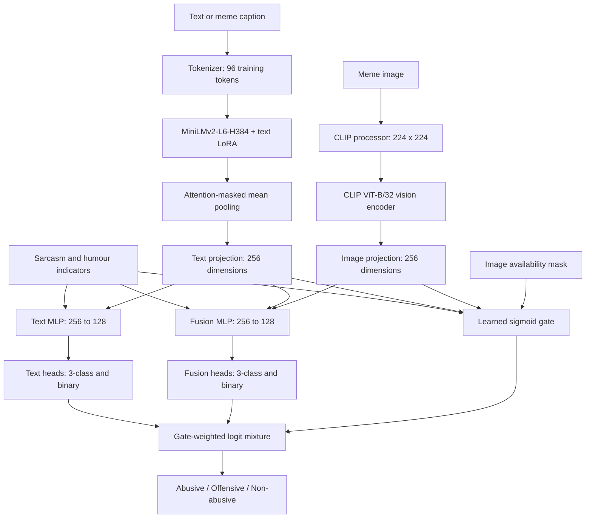

# Multimodal Hate Speech Detection

Research notebook for classifying text and memes as **Abusive**, **Offensive**, or **Non-abusive**. The model combines MiniLM text features and CLIP image features, adapts the text encoder with LoRA, and learns how much to rely on text-only and multimodal predictions.

Includes preprocessing, training, evaluation, OCR-assisted inference, a Gradio demo, and exploratory data analysis. **Datasets, trained checkpoints, and measured results are not included.**

## Architecture



The gate mixes branch logits:

```text
g = sigmoid(gate_MLP([text_projection, image_projection, metadata])) * has_image
logits = g * fusion_logits + (1 - g) * text_logits
```

A missing image sets `g = 0`, selecting the text branch. Each projection uses Linear → LayerNorm → GELU → Dropout. Each branch has a three-class head and a binary head; the binary task groups abusive and offensive content together. Metadata contains sarcasm and humour indicators.

### Model and training defaults

| Component | Default |
| --- | --- |
| Text encoder | `nreimers/MiniLMv2-L6-H384-distilled-from-RoBERTa-Large` |
| Vision encoder | `openai/clip-vit-base-patch32` |
| Text adaptation | LoRA on query/value modules; rank 8, alpha 16, dropout 0.1 |
| Vision adaptation | Frozen; vision LoRA is optional |
| Alternative vision encoders | MobileNetV2 or ResNet18 when CLIP is disabled |
| Projection / hidden / branch representation | 256 / 256 / 128 dimensions |
| Batch size / learning rate | 32 / `1e-4` |
| Training budget | Up to 30 epochs; patience 4 |
| Text sampling | 5,000 examples per epoch; hard-mining fraction 0.6 |
| Meme sampling | 200 image examples per epoch |
| Regularization | Dropout 0.25, label smoothing 0.05, text dropout probability 0.25 |

The loss combines three-class soft cross-entropy, binary classification, hierarchical consistency, and an auxiliary fusion-branch loss on samples with images. The auxiliary term is called “image-only” in the notebook, but that branch also receives text unless text dropout removes it. Mixed precision and gradient checkpointing are configurable.

## Data and labels

Text cleaning normalizes Unicode, expands contractions where possible, removes URLs/emails, and normalizes whitespace and repeated punctuation.

| Dataset folder under `datasets/` | Expected files | Label construction |
| --- | --- | --- |
| `hate_speech_curated` | `HateSpeechDataset.csv`, `HateSpeechDatasetBalanced.csv` | `Content` and binary `Label` |
| `hate_speech_and_offensive_language` | `labeled_data.csv` | `tweet`; preserves `class` as `original_class` |
| `suspicious_communication_on_social_platforms` | `Suspicious Communication on Social Platforms.csv` | `comments` and binary `tagging` |
| `jigsaw-toxic-comment-classification-challenge` | `train.csv`, optionally `test.csv` with `test_labels.csv` | Any positive toxicity annotation becomes binary positive |
| `memotion_dataset_7k` | `labels.csv` or `labels.xlsx`, plus `images/` | Caption, image, offensive category, and metadata |

| ID | Target | Mapping |
| --- | --- | --- |
| 0 | Abusive | Original text class 0; Memotion `hateful_offensive` |
| 1 | Offensive | Original text class 1; Memotion `offensive` or `very_offensive`; positive binary-only text labels |
| 2 | Non-abusive | Original text class 2; Memotion `not_offensive` or `slight`; negative binary-only text labels |

These are project-specific mappings. Toxicity and offensive-language labels are broader than verified hate-speech annotations. Binary-only corpora cannot supply the same three-class supervision as fully labeled examples.

Text is deduplicated and split **70/15/15**, stratified by binary label with seed 42. The loader splits Memotion **80/10/10** with seed 123. Obtain datasets separately and follow their original usage terms; no verified download archive is supplied here.

## Setup

Use an isolated environment. Python 3.10 or 3.11 is a starting point for the ML/OCR dependencies; an exact tested environment has not been recorded. A CUDA-capable GPU is recommended for training. Initial encoder and OCR loading may download weights.

```powershell
git clone https://github.com/abhinavg08/MultiModel-Hate-Speech-Detection.git
cd MultiModel-Hate-Speech-Detection
py -3.11 -m venv .venv
.\.venv\Scripts\Activate.ps1
python -m pip install --upgrade pip
python -m pip install -r requirements.txt
python -m ipykernel install --user --name hate-speech-detection
jupyter lab Project_12.ipynb
```

For CUDA, install the PyTorch/torchvision build appropriate for your hardware. Install `requirements-optional.txt` for the OCR demo and additional EDA. The alternative PaddleOCR backend needs a compatible PaddlePaddle installation configured separately.

### Local data layout

```text
datasets/
├── hate_speech_curated/
├── hate_speech_and_offensive_language/
├── suspicious_communication_on_social_platforms/
├── jigsaw-toxic-comment-classification-challenge/
├── memotion_dataset_7k/
│   ├── labels.csv
│   └── images/
└── processed_data/                    # generated
    ├── ALL_TEXT_DATASETS_COMBINED.csv
    ├── memotion_7k_multimodal.csv
    ├── splits/
    │   ├── train/text_train.csv
    │   ├── val/text_val.csv
    │   └── test/text_test.csv
    └── best_novel.pt                  # generated by training
```

**Configure image loading before training:** loaders rebuild paths under `datasets/processed_data/memotion_dataset_7k/images/`, while preprocessing reads `datasets/memotion_dataset_7k/images/`. Update `img_root` in the chosen training/evaluation loader to the original image directory, or provide images at the expected location. Confirm images load; missing files can silently produce text-only predictions.

## Notebook workflow

Cell numbers count all code and Markdown cells from **1**. Run sections selectively; training and evaluation redefine overlapping classes and configuration objects.

| Cells | Purpose | Action |
| --- | --- | --- |
| 1–2 | Text preparation | Run after placing text datasets locally |
| 3–4 | Memotion preparation | Validate captions, labels, and image files |
| 5–6 | Training and architecture notes | Cell 5 trains and saves `best_novel.pt` |
| 7–8 | Alternative training/evaluation | Defaults to `RUN_TRAIN=False`; loads an existing checkpoint |
| 9–10 | OCR inference and demo | Requires a checkpoint; launches local Gradio |
| 11–15 | Text EDA and classical baselines | Install optional packages, consolidate splits, then analyze |
| 17–18 | Memotion EDA | Analyze captions, labels, and image properties |

Restart the kernel between independent training, inference, and EDA workflows. Cell 7 can train with `RUN_TRAIN=True`, but uses a different checkpoint-selection rule from cell 5; see [experiment notes](docs/EXPERIMENTS.md).

### Inference

After running cell 9 with a trained checkpoint:

```python
# Text classification
result = user_predict("A neutral example sentence.", use_ocr=False)
print(result["final_label"], result["final_probs"])

# Supplied caption plus image
result = user_predict("A caption to inspect", image="example.png", use_ocr=False)

# OCR caption with the image branch enabled
result = user_predict("", image="example.png", use_ocr=True,
                      ignore_image_when_ocr=False)

# Batch CSV: text, image_path, optional sarcasm/humour columns
predict_csv("examples.csv", out_path="predictions.csv", use_ocr=False)
```

EasyOCR is the default. Successful OCR replaces the typed caption. The default `FORCE_TEXT_ONLY_WHEN_OCR=True` also disables the image branch for that prediction; set it to `False` or use the override above for multimodal inference. Outputs include class probabilities, label, gate weight, OCR text, and final model input. Temperature defaults to 1.0; no fitted calibration result is supplied.

The default checkpoint is `datasets/processed_data/best_novel.pt`; inference also accepts the `CKPT_PATH` environment variable. Gradio launches locally with `share=False`.

## Evaluation and analysis

Deep-learning sections implement classification reports, confusion matrices, direct three-class accuracy/F1, combined abusive/offensive precision–recall analysis, calibration diagnostics, gate analysis, and prediction CSV export. Outputs go to `datasets/processed_data/reports_novel/` or `datasets/processed_data/novel_eval_insights/`, depending on the workflow.

Text EDA includes n-grams, linguistic features, distributions, word clouds, and Logistic Regression/Random Forest/optional XGBoost baselines, writing to `figures_full/`. Memotion EDA examines captions, labels, image sizes, and correlations, writing to `figure_multimodal/`.

**No benchmark scores are claimed:** the supplied notebook has no saved execution outputs, weights, or evaluation artifacts. Syntax checks do not establish successful end-to-end execution or model performance.

## Limitations

- Dataset label definitions differ, and exact-text deduplication does not remove every near-duplicate or related meme.
- Memotion splits are not stratified or grouped by image similarity.
- Some cleaning removes capitalization and punctuation signals later examined by EDA.
- Classical EDA baselines fit transformations before their analysis split; scores are exploratory and may be optimistic.
- Sarcasm/humour annotations used during training may be unavailable during inference.
- OCR errors, dialect, quotation, context, and domain shift can affect predictions; this research prototype requires human review.

See [experiment notes](docs/EXPERIMENTS.md) for reproducibility and checkpoint-selection details. Original datasets and pretrained models retain their own terms. No project license was included in the supplied files.
